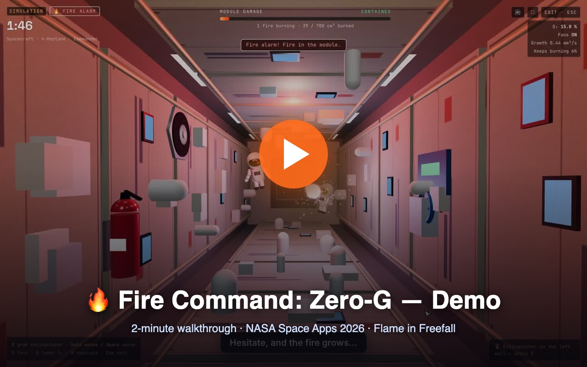
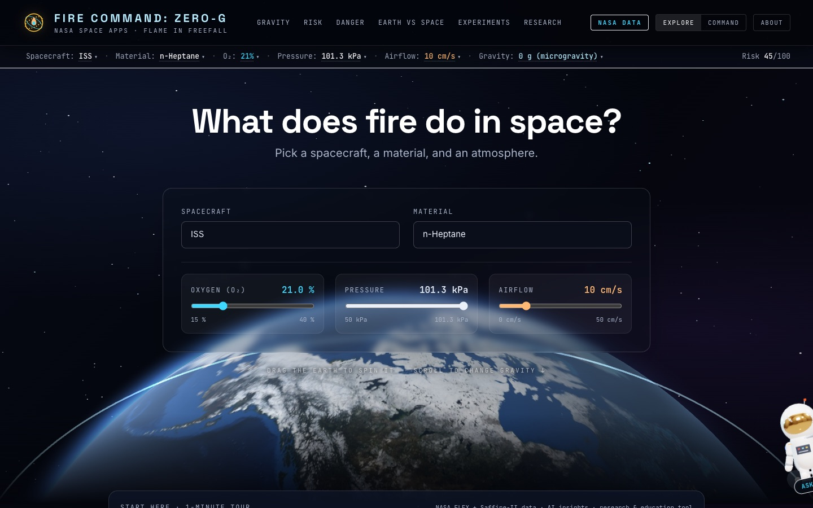
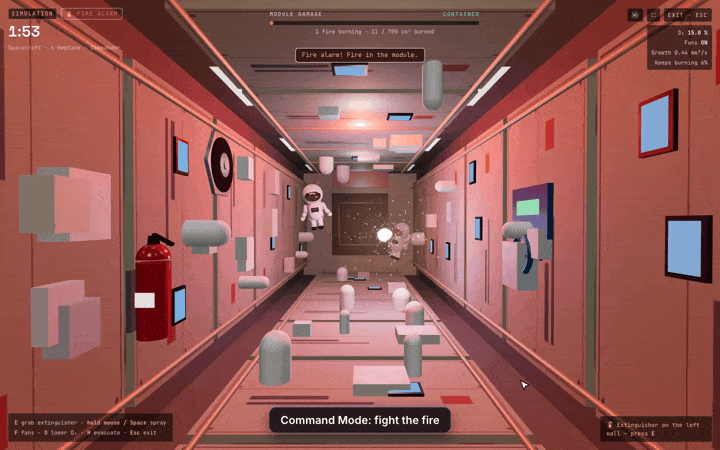
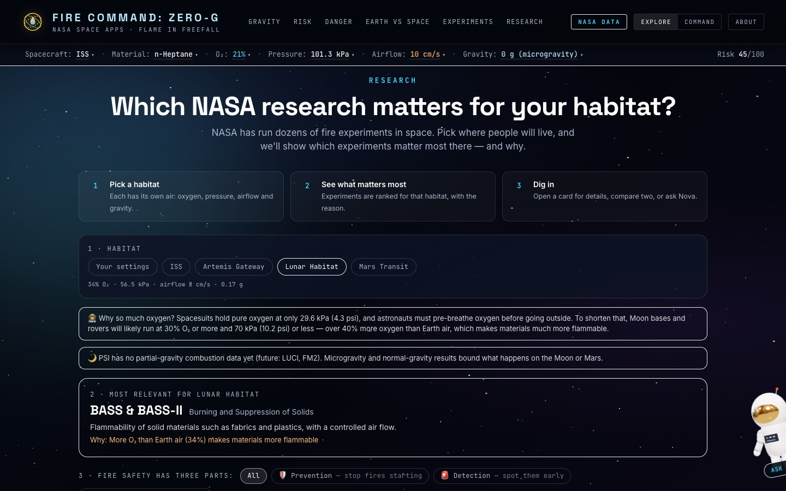
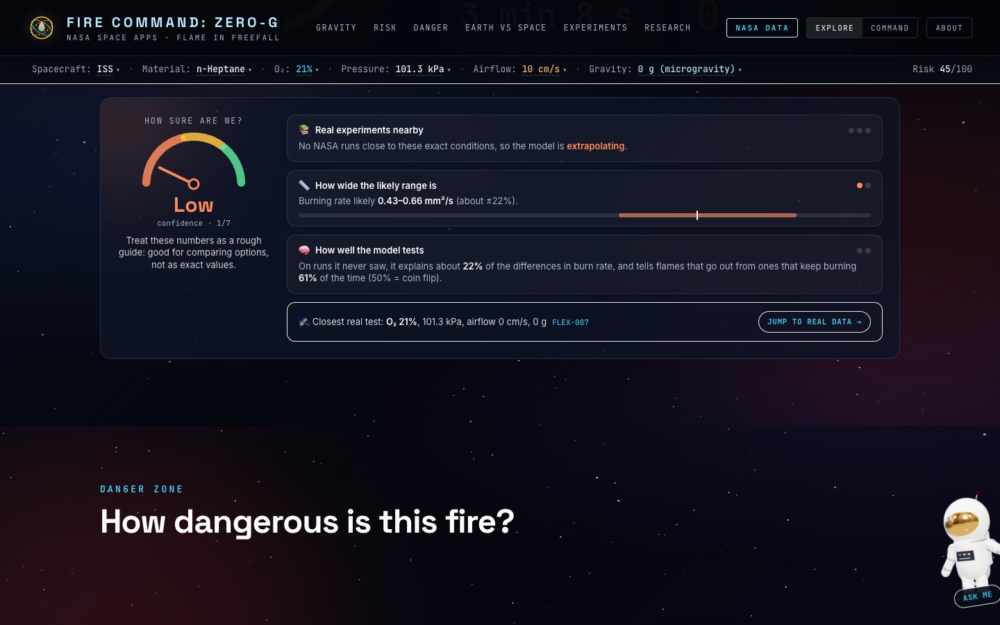
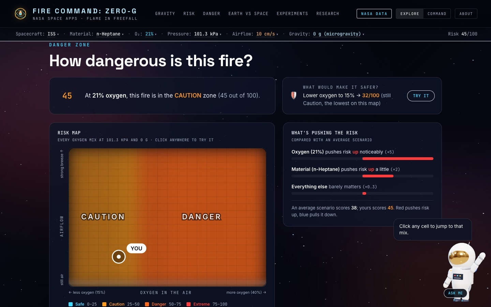
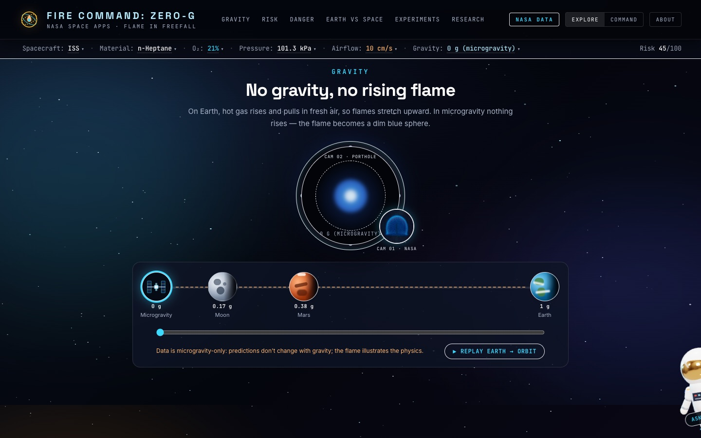
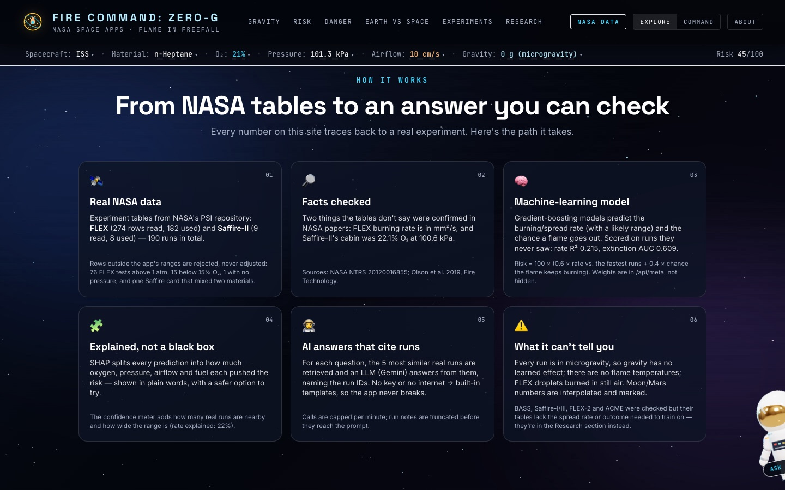
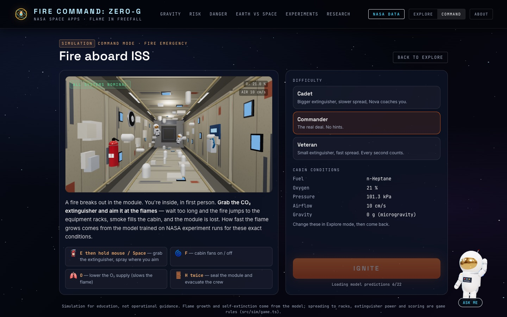

<div align="center">

# 🔥 Fire Command: Zero-G

### AI-powered fire safety from NASA's microgravity combustion experiments

**NASA Space Apps Challenge 2026 · *Flame in Freefall***

**▶ Live demo:** deploying soon · [**🎬 Demo video**](https://www.youtube.com/watch?v=hW-65ah_B58) · [How it works](#how-it-works) · [NASA data](#nasa-data) · [Run it locally](#quick-start)

<a href="https://www.youtube.com/watch?v=hW-65ah_B58"></a>
<sub><b>▶ Click to watch the 2-minute demo on YouTube</b> (narrated walkthrough: prediction → confidence → NASA research for a Moon base → fighting a fire)</sub>

<sub>(no YouTube? <a href="docs/media/demo.mp4">play the video file here</a>)</sub>

</div>

---

On Earth a flame is a flickering teardrop. In orbit, with no buoyancy, it becomes a **dim blue sphere** that lives on diffusion alone — and NASA has spent decades lighting fires in space to learn how they start, spread and die.
That knowledge is scattered across dozens of investigations. **Fire Command: Zero-G turns it into answers**: pick a habitat — the ISS, the Artemis Gateway, a Moon base, a Mars transit ship — and see which NASA research matters there, what a fire would do, how sure we are, and what would make it safer.

> Research and education tool built on public NASA data. Not operational fire-safety guidance.



<div align="center">

<sub><b>Command Mode</b> — a real-time fire in a 3D station module. How fast the flame grows comes from the model trained on NASA data.</sub>
</div>

## ✅ How it answers the challenge

The challenge: *an SI-powered web dashboard that **summarizes, ranks and interprets** combustion science investigations to deliver fire-safety insights.*

| The challenge asks… | Fire Command: Zero-G |
|---|---|
| **Summarize** investigations | 12 PSI investigations (BASS, Saffire, SAME, DAFT, FLEX, FLEX-2, CFI, ACME's BRE / CFI-G / E-FIELD, SPICE, SLICE): what each studied, hardware, fuel samples, measurements, and an **AI summary** on demand |
| **Rank** them | Ranked by relevance to a chosen habitat's **oxygen, pressure, airflow and gravity** — every placement shows *why* |
| **Interpret** them | Machine-learning predictions from **190 real NASA runs**, plain-language risk drivers, a *safer option*, and a **"How sure are we?"** meter |
| Habitats: spacecraft, stations, Moon/Mars bases, rovers | ISS · Artemis Gateway · Lunar Habitat (34 % O₂, 56.5 kPa) · Mars Transit · or your own settings |
| Extract data for predictive modeling | One-click **CSV download** of every run behind the model |
| Research for next-gen safety equipment | Every investigation tagged **🛡 Prevention · 🚨 Detection · 🧯 Suppression**, with what it informs (detectors, cabin materials, extinguishing agents) |
| Fire safety on Earth | NASA spin-offs: fine-water-mist extinguishers, smoke detection, firefighter gear |
| Partial gravity | Handled honestly: PSI has **no** partial-gravity data, so Moon/Mars values are interpolated, flagged, and given wider ranges |

## 🛰 What's inside

<table>
<tr>
<td width="50%"><br/><b>Which NASA research matters for your habitat?</b><br/>Pick a habitat; investigations re-rank with a reason. Filter by prevention / detection / suppression, compare two side by side, ask Nova.</td>
<td width="50%"><br/><b>How sure are we?</b><br/>Real runs nearby, width of the likely range, and the model's held-out accuracy — with a one-click <i>Jump to real data</i>.</td>
</tr>
<tr>
<td><br/><b>Danger zone</b><br/>A risk map across oxygen × airflow, a plain verdict ("Caution, 45/100"), what's pushing the risk, and a safer option to try.</td>
<td><br/><b>No gravity, no rising flame</b><br/>Slide from Earth to orbit and watch the flame morph from teardrop to sphere, next to a real NASA microgravity photo.</td>
</tr>
<tr>
<td><br/><b>How it works</b><br/>From NASA tables to an answer you can check — with the real numbers, the checks we did, and what the data can't tell you.</td>
<td><br/><b>Command Mode</b><br/>A first-person fire emergency: grab the extinguisher, aim, and stop the fire before it spreads to the racks. Three difficulty levels.</td>
</tr>
</table>

Plus **Nova**, a 3D astronaut assistant (Gemini, with voice) that answers questions **citing real NASA run IDs**; a downloadable **fire-safety report**; and a **1-minute tour** for first-time visitors. Works on phones.

## How it works

```
NASA PSI tables ──► validate & map ──► gradient-boosting models ──► API ──► dashboard
 FLEX  274 rows        reject, never        burning/spread rate          FastAPI     React + three.js
 Saffire-II 9 rows      adjust: 190 kept     + likely range               /api/*      Nova (Gemini, cites runs)
                                            extinction probability
                                            SHAP explanations
```

1. **Real NASA data.** FLEX (PSI-69, droplet flames on the ISS: 182 runs used) and Saffire-II (PSI-99, large material fires in a Cygnus cargo ship: 8 used). Rows outside the app's ranges are rejected, never adjusted.
2. **Facts checked.** FLEX burning rate is in mm²/s (confirmed in NASA NTRS 20120016855); Saffire-II's cabin was 22.1 % O₂ at 100.6 kPa (Olson et al. 2019).
3. **Model.** Gradient boosting predicts the burning/spread rate (with 10–90 % quantile range) and the chance a flame goes out; cross-validated scores are published at `/api/meta` and shown in the app.
4. **Explained.** SHAP turns each prediction into "oxygen pushes risk up noticeably (+5)".
5. **AI, grounded.** For every question the 5 most similar real runs are retrieved and Gemini answers from them, citing run IDs (validated). No key or no internet → deterministic templates; the app never breaks.

### Honest limits
- Every run is in **microgravity**, so the model has no learned gravity effect; Moon/Mars values are interpolated and labelled.
- Held-out accuracy is **modest** (rate R² ≈ 0.22, extinction AUC ≈ 0.61) — the app shows this rather than hiding it.
- Only FLEX and Saffire-II have tables that can train a model; the other investigations are catalogued (with links and the reason) in Research.
- Command Mode's spreading, extinguisher and scoring are **game rules**, clearly labelled.

## NASA data
| | Investigation | Source |
|---|---|---|
| 🔥 | FLEX — Flame Extinguishment Experiment | [PSI-69 · doi:10.60555/mbq8-0451](https://doi.org/10.60555/mbq8-0451) |
| 🔥 | Saffire-II — Spacecraft Fire Safety Demonstration | [PSI-99 · doi:10.60555/2chp-m469](https://doi.org/10.60555/2chp-m469) |
| 📄 | Methanol droplet extinction in microgravity | [NASA NTRS 20120016855](https://ntrs.nasa.gov/api/citations/20120016855/downloads/20120016855.pdf) |
| 📋 | Investigation descriptions | [2026 Space Apps challenge statement](https://www.spaceappschallenge.org/2026/challenges/flame-in-freefall/) |

Data is CC0 (public domain). Provenance, hashes and every assumption: [`data/SOURCES.md`](data/SOURCES.md). Images: NASA ([credits](frontend/src/assets/nasa/CREDITS.md)).

**Built with** React · TypeScript · Vite · Tailwind · three.js / react-three-fiber · Zustand · FastAPI · scikit-learn · SHAP · Google Gemini.

---

# For developers

## Quick start

```bash
cp .env.example .env     # optional; STUB_MODE=0 (trained model) is the default
make setup               # python venv + deps (+ npm ci once /frontend exists)
make dev                 # backend http://localhost:8000  +  frontend http://localhost:5173
```

Requirements: Python 3.11 or 3.12 (not 3.13, see I-26), Node 20, `make`.

Backend only: `cd backend && .venv/bin/uvicorn main:app --reload` (interactive API docs at http://localhost:8000/docs).

| Command | What it does |
|---|---|
| `make setup` | create `backend/.venv`, install pinned deps, `npm ci` if the frontend exists, create `.env` |
| `make dev` | run backend (:8000) and frontend (:5173); Ctrl-C stops both; refuses if a port is busy |
| `make test` | backend tests (mock trends, loader rules, API contract) |
| `make smoke` | automated part of the smoke test (health, meta, predict) |
| `make mock` | regenerate `data/mock_combustion_runs.csv` (deterministic, seed 20241014) |
| `make train` | train and cache the model on the active data (`--force` to retrain) |
| `python backend/sanity_check.py` | 5 behaviour checks (O₂ raises risk, blow-off, starvation, cooler 0 g flames, heatmap corners); run before every demo |
| `make validate-data FILE=data/combustion_runs.csv` | validate a real CSV and print `backend/data_report.json` |

## Data: MOCK vs NASA

- `data/combustion_runs.csv` present and valid → **NASA DATA** badge. Present but invalid → the backend refuses to start and says why (it never silently falls back to mock).
- Absent → the deterministic mock file `data/mock_combustion_runs.csv` is used → **MOCK DATA** badge. Every mock row's `source_note` starts with `[MOCK]`.
- Column schema: `data/schema.json` (details in `docs/03_DATA_CONTRACT.md`). To plug in real NASA PSI data, follow section 4 of that doc, drop the CSV in `data/`, restart.

### Real NASA data (built, not active)

`make real-data` builds `data/candidate/combustion_runs.csv` from NASA PSI FLEX (droplets) and Saffire-II (solids), CC0; see [`data/SOURCES.md`](data/SOURCES.md).
Try it without activating: `make train DATA=data/candidate/combustion_runs.csv` and `make sanity DATA=data/candidate/combustion_runs.csv`.
Activate with `make promote-real` and restart: the badge becomes NASA DATA and the model retrains. **Be aware:** the real data is all 0 g, has no flame temperature and only
two predictable materials (methanol, heptane), so `meta.model.capabilities` is false/false, `flame_temp_k` is null and the Earth-vs-Space comparison has no real basis.

## Risk Index (shown verbatim in the dashboard tooltip)

```
spread_norm = clip(spread_rate_mm_s / SPREAD_REF, 0, 1)        SPREAD_REF = 99th percentile of spread rate in the training data
risk_index  = 100 × ( 0.6 × spread_norm + 0.4 × (1 − extinction_probability) )
```

0 = flame dies at once and barely moves; 100 = fastest-spreading flame that certainly survives. It is a **relative score, not a probability of loss**.
A flame that survives but spreads very slowly scores about 40, so the "SAFE ZONE" (risk < 25) needs both slow spread and a high chance of self-extinguishing.
Bands: low < 25 ≤ elevated < 50 ≤ high < 75 ≤ critical. All constants live in `backend/config.py` and are published at `/api/meta`.

## Model

Gradient boosting (scikit-learn): spread rate (+ 10%/90% quantile models for the interval), flame temperature, and an extinction classifier, trained on the active dataset at startup
(background thread; endpoints return 503 `MODEL_NOT_READY` until ready) and cached in `backend/models/` keyed by the data hash, so replacing the CSV retrains automatically.
SHAP explains the risk in risk-index points. Metrics are in `/api/meta` (`model.metrics`); on mock data they show how well the model recovers the generator, not physics.

## AI insights

`/api/insights` and `/api/ask` retrieve the 5 most similar runs, then (if `LLM_API_KEY` is set in `.env`) ask the configured LLM (`LLM_PROVIDER=openai|anthropic`, optional `LLM_BASE_URL` for compatible servers) to explain them.
Every citation is validated against the retrieved runs; anything invalid, slow (>`LLM_TIMEOUT_S`), rate-limited or failing falls back to deterministic templates computed from the same runs, so the app never breaks and works offline.
Responses say which path produced them (`generated_by`). Never put the key anywhere except `.env`.

## Stub mode

`STUB_MODE=1` serves every endpoint from a cheap analytic surface with realistic directions (more O₂ → faster, 0 g → cooler, starved flames die),
so the frontend can be built before the model exists. `/api/meta.model.stub` is `true` and the UI shows a STUB tag. Retrieval, matching-run counts and citations are real (computed from the loaded runs).

## Layout

```
backend/    FastAPI app, loader, mock generator, scoring, retrieval, tests   (Track A)
frontend/   React + Vite dashboard                                             (Track B)
data/       schema.json, vocab.json, mock CSV, (real CSV + SOURCES.md later)
docs/       contracts, invariants, risks, tasks, fixtures
scripts/    dev.sh
```

## API

Full contract: [`docs/02_API_CONTRACT.md`](docs/02_API_CONTRACT.md), examples in `docs/fixtures/`.
`GET /api/health` · `GET /api/meta` · `GET /api/runs` · `POST /api/predict` · `POST /api/heatmap` · `POST /api/compare` · `POST /api/insights` · `POST /api/ask` · `POST /api/passport` · `POST /api/advise`
